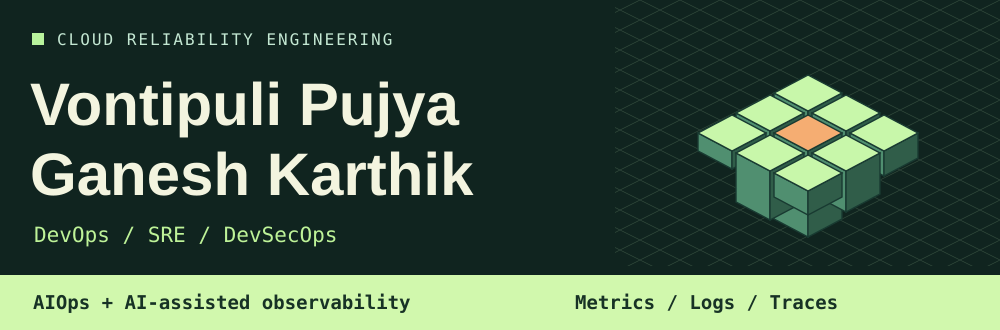

I build the infrastructure underneath applications. On **RoboShop**, I provisioned AWS resources, configured Linux services, and tracked down failures between application processes, queues, and databases. I’m working toward **DevOps, SRE, and DevSecOps** roles.

### Explore my infrastructure work

| Provision on AWS | Configure Linux services | Isolate the network |
| --- | --- | --- |
| [**RoboShop infrastructure ↗**](https://github.com/VONTIPULIPUJYAGANESHKARTHIK/roboshop-infra-dev) | [**RoboShop Ansible ↗**](https://github.com/VONTIPULIPUJYAGANESHKARTHIK/roboshop-ansible-v2) | [**Terraform security groups ↗**](https://github.com/VONTIPULIPUJYAGANESHKARTHIK/terraform-aws-sg) |
| Terraform resources for a multi-service deployment | Repeatable configuration for application hosts | Reusable AWS security group configuration |

## Field notes from RoboShop

**Five tiers · Amazon EC2 · RHEL 9**

- **A backend was unreachable.** I checked DNS resolution, listening ports, and EC2 security group rules to trace connectivity between hosts.
- **A health check failed.** I investigated Redis and RabbitMQ runtime behavior to identify why dependent services were failing their checks.
- **The payment service stalled at startup.** I debugged the `systemd` configuration and Gunicorn startup sequence for the Python service.

### Build and release

For Node.js applications, I wired GitHub webhooks to Jenkins declarative pipelines for build, test, and deployment. I packaged services with Docker, used rolling updates in Kubernetes, and wrote Ansible playbooks to keep staging and production hosts consistent.

[Terraform VPC](https://github.com/VONTIPULIPUJYAGANESHKARTHIK/terraform-aws-vpc) · [EC2 instance module](https://github.com/VONTIPULIPUJYAGANESHKARTHIK/terraform-aws-instance) · [Bash scripting](https://github.com/VONTIPULIPUJYAGANESHKARTHIK/learn-shell)

## AI engineering

My computer vision work at **IIT Tirupati** took me from model workflows to cross-platform applications and containerized deployment. At **IIT Ropar**, I used deep learning to analyze data for a remote health-monitoring project. Alongside supervised learning, I’m interested in **reinforcement learning**, especially how policies respond to changes in their environment.

| Where AI meets operations | What interests me |
| --- | --- |
| **MLOps** · Operating models | Tracking which model and dataset produced a release, packaging inference as a service, and checking model quality after deployment. |
| **AIOps** · Applying AI to operations | Using logs and metrics to spot unusual service behavior and narrow down the cause of an incident. |

## Research internships

B.Tech. in Artificial Intelligence and Data Science · Amrita Vishwa Vidyapeetham · 2024–2028

| IIT Tirupati | IIT Ropar |
| :--- | :--- |
| **Summer Research Intern · Vision Technology Lab** | **Summer Research Intern · School of AI & Data Engineering** |
| `Jun – Jul 2026` | `May – Aug 2025` |
| Built cross-platform computer vision and surveillance workflows using **Flutter** and containerized deployment. | Conducted deep learning data analysis for a health-monitoring project using **remote photoplethysmography (rPPG)**. |

## Certifications

| Credential | Issuer |
| --- | --- |
| **Certification in Artificial Intelligence and Machine Learning** | Vishlesan i-Hub, Indian Institute of Technology Patna |
| **Microsoft Certified: Azure Fundamentals** (AZ-900) | Microsoft |

## Experience & leadership

| Role | Focus |
| --- | --- |
| **Software Development / AI Summer Intern** · Amrita Vishwa Vidyapeetham | AI and Data Science department, Jun–Aug 2026 |
| **Conversational AI Developer Apprentice** · FutureSkills and NASSCOM | AI and Data Engineering, Jan–Mar 2026 |
| **Vice President** · Campus Startup Club | Supported student engagement, technical activities, and entrepreneurship initiatives. |

I’ve also designed backend workflows for **FinScholar**, an AI-driven student loan advisory app, and built a **Flask document-parsing service** integrated with Google Cloud AI APIs.

<strong>Open the full infrastructure toolbox</strong>

**Cloud & infrastructure**

AWS networking and access include VPC, Route 53, ELB, and IAM. Compute, storage, and managed services include EC2, S3, RDS, and EKS.

    

**Containers & delivery**

    

**Linux & networking**

RHEL, CentOS, Ubuntu, and Arch Linux · Bash and `systemd` · Nginx, DNS, load balancing, and ingress

**Observability**

  

  <a href="https://github.com/VONTIPULIPUJYAGANESHKARTHIK?tab=repositories"><strong>Explore all repositories →</strong></a>

