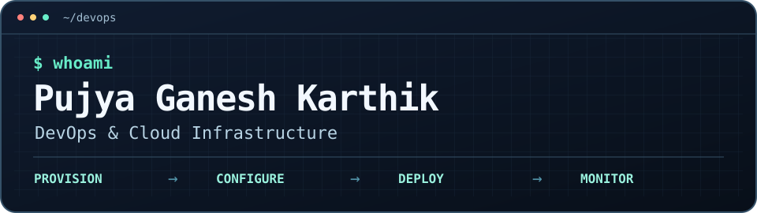

  

  <a href="#devops-projects">DevOps projects</a> · <a href="#ai-engineering">AI engineering</a> · <a href="#research-internships">IIT research</a> · <a href="#certifications">Certifications</a> · <a href="#experience--leadership">Experience</a> · <a href="#toolbox">Toolbox</a>

I’m working toward roles in **DevOps, site reliability engineering (SRE), and DevSecOps**. On RoboShop, that meant writing Terraform for AWS, automating Linux configuration, and following a failed health check through DNS, security groups, and service logs. I especially enjoy the point where a deployment stops behaving as expected and the debugging begins.

**Machine learning and deep learning** are also strengths of mine. My research spans computer vision and health-monitoring data, and I’m interested in how those models are deployed, observed, and maintained.

I’m **Vontipuli Pujya Ganesh Karthik**, a B.Tech. student in AI and Data Science at **Amrita Vishwa Vidyapeetham** (2024–2028) and a former research intern at **IIT Tirupati** and **IIT Ropar**.

## DevOps projects

### RoboShop on AWS

Deployed a five-tier microservices application on **AWS EC2 with RHEL 9**. I traced DNS and port connectivity issues, diagnosed Redis and RabbitMQ health-check failures, and debugged Gunicorn and `systemd` startup issues in the payment service.

[Explore the AWS infrastructure →](https://github.com/VONTIPULIPUJYAGANESHKARTHIK/roboshop-infra-dev) · [Explore the Ansible automation →](https://github.com/VONTIPULIPUJYAGANESHKARTHIK/roboshop-ansible-v2)

| Area | What I built |
| --- | --- |
| **Infrastructure as code** | Provisioned AWS VPCs, subnets, EC2 instances, and security groups with Terraform. Used reusable Ansible playbooks for server setup and configuration. [Terraform VPC →](https://github.com/VONTIPULIPUJYAGANESHKARTHIK/terraform-aws-vpc) |
| **CI/CD automation** | Built Jenkins declarative pipelines for Node.js that ran build, test, and deploy stages. Used GitHub webhooks for commit-triggered builds, Docker for packaging, and Kubernetes for rolling updates. |
| **Linux automation** | Wrote Bash scripts and practiced Linux service configuration. [Shell scripting →](https://github.com/VONTIPULIPUJYAGANESHKARTHIK/learn-shell) |

## AI engineering

My computer vision work at **IIT Tirupati** took me from model workflows to cross-platform applications and containerized deployment. At **IIT Ropar**, I used deep learning to analyze data for a remote health-monitoring project. Alongside supervised learning, I’m interested in **reinforcement learning**, especially how policies respond to changes in their environment.

| Where AI meets operations | What interests me |
| --- | --- |
| **MLOps** · Operating models | Tracking which model and dataset produced a release, packaging inference as a service, and checking model quality after deployment. |
| **AIOps** · Applying AI to operations | Using logs and metrics to spot unusual service behavior and narrow down the cause of an incident. |

## Research internships

| IIT Tirupati | IIT Ropar |
| :--- | :--- |
| **Summer Research Intern · Vision Technology Lab** | **Summer Research Intern · School of AI & Data Engineering** |
| `Jun – Jul 2026` | `May – Aug 2025` |
| Built cross-platform computer vision and surveillance workflows using **Flutter** and containerized deployment. | Conducted deep learning data analysis for a health-monitoring project using **remote photoplethysmography (rPPG)**. |

## Certifications

| Credential | Issuer |
| --- | --- |
| **Certification in Artificial Intelligence and Machine Learning** | Vishlesan i-Hub, Indian Institute of Technology Patna |
| **Microsoft Certified: Azure Fundamentals** (AZ-900) | Microsoft |

## Experience & leadership

| Role | Focus |
| --- | --- |
| **Software Development / AI Summer Intern** · Amrita Vishwa Vidyapeetham | AI and Data Science department, Jun–Aug 2026 |
| **Conversational AI Developer Apprentice** · FutureSkills and NASSCOM | AI and Data Engineering, Jan–Mar 2026 |
| **Vice President** · Campus Startup Club | Supported student engagement, technical activities, and entrepreneurship initiatives. |

I’ve also designed backend workflows for **FinScholar**, an AI-driven student loan advisory app, and built a **Flask document-parsing service** integrated with Google Cloud AI APIs.

## Toolbox

**Cloud & infrastructure**

    

**Containers & delivery**

    

**Observability**

  

  <a href="https://github.com/VONTIPULIPUJYAGANESHKARTHIK?tab=repositories"><strong>Explore all repositories →</strong></a>

